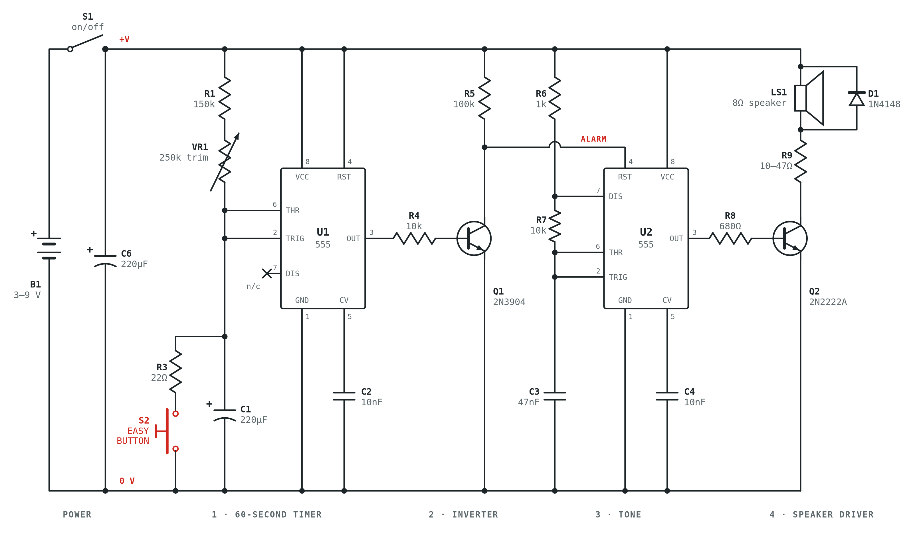
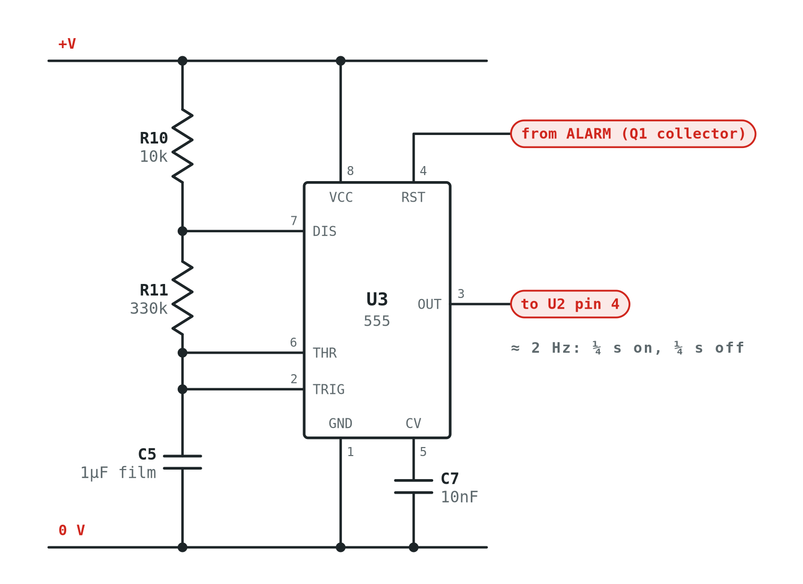
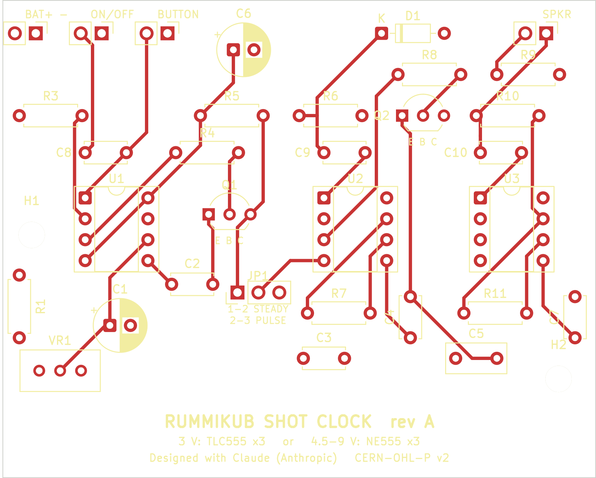
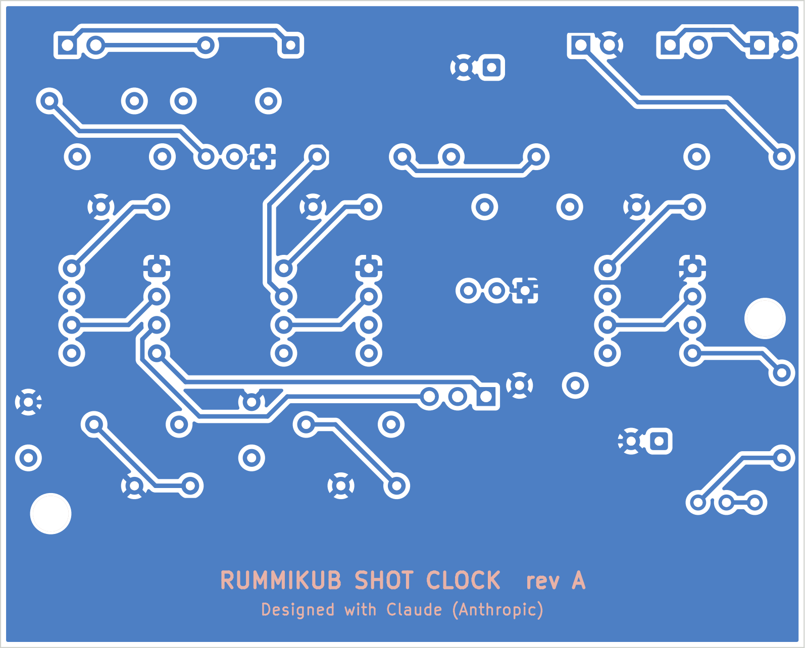

# Rummikub Shot Clock

A 60-second turn timer that fits inside one of those novelty "Easy" buttons. Press the button to end your turn: the next player's 60 seconds start. If time runs out, it beeps until somebody presses the button.



> **Status: rev A, not yet built or tested.** The schematic and PCB pass KiCad's design-rule check, but nobody has built a board yet. Breadboard it first, and please open an issue with what you find.

## How it works

| Stage | Part | What it does |
|---|---|---|
| Timer | U1 (555) | A one-shot. The Easy Button shorts the timing cap C1, which triggers the 555 and restarts the count. After about 1.1 × (R1 + VR1) × C1, the output goes low. Pin 7 is not used, so C1 keeps charging and the timer never retriggers itself. |
| Inverter | Q1 | Turns "timer finished" into ALARM high. |
| Tone | U2 (555) | An oscillator at about 1.5 kHz, held in reset until ALARM goes high. |
| Pulser (optional) | U3 (555) | About 2 Hz on/off, for a beep-beep-beep instead of a steady tone. Set it with JP1. |
| Driver | Q2 | Drives the button's 8 Ω speaker. |

What it does when used:

- **Every press restarts the full time**, whether you press during the countdown or during the beep. Contact bounce doesn't matter.
- **At power-on the countdown starts by itself.**

The optional pulser is shown here:



## Choosing a 555 and a battery

The board takes either type of 555. They have the same pinout and footprint, so the only difference is the power supply.

| Chips | Battery | R9 | Idle current | Notes |
|---|---|---|---|---|
| **TLC555 / LMC555 / ICM7555** (CMOS) | 2×AA or 2×AAA (3 V) | 10 Ω ¼ W | ~0.3 mA | Lowest drain. Uses the button's own 2-cell holder if it has one |
| **NE555** (bipolar) | 4×AA or 4×AAA (6 V) | 22 Ω ½ W | ~10–15 mA | The cheap 555s from bulk packs |
| **NE555** (bipolar) | 9 V battery | 47 Ω ½ W | ~10–15 mA | Fewer hours, but easy to fit |

- **An NE555 needs at least 4.5 V,** so it won't run from 2 cells. 3 cells (4.5 V) is marginal and quits as the batteries run down. Use 4 cells or a 9 V battery.
- **R9 sets the speaker current.** Raise it with the supply voltage as shown so it doesn't overheat.
- **Nothing else changes.** The turn length works the same at any supply voltage, so VR1 has the same range. The capacitors are rated 16 V.
- **Current while beeping** is about 150–200 mA with any option. Use the power switch between game nights, especially with NE555s.

## Ordering boards

Upload **`pcb/rummikub-shot-clock-gerbers.zip`** to any PCB fab (JLCPCB, PCBWay, OSH Park and so on).

| Setting | Value |
|---|---|
| Layers | 2 |
| Size | 72 × 58 mm |
| Thickness | 1.6 mm |
| Copper | 1 oz |
| Minimum track / space | 0.4 / 0.25 mm |
| Smallest drill | 0.45 mm (vias) |
| Parts | All through-hole |

The default settings at any fab will do.

| Front | Back |
|---|---|
|  |  |

**Check the size before you order.** Measure the inside of your Easy Button. The board is 72 × 58 mm and has two M3 mounting holes. If it doesn't fit, the layout scripts in `tools/` make it easy to change the outline and rebuild.

## Parts

See [`pcb/BOM.csv`](pcb/BOM.csv). For a steady tone only, leave out U3, R10, R11, C5, C7 and C10, and fit the JP1 jumper on pins 1-2.

## Building and setup

1. **Gut the button.** Cut or lift the traces from the original sound chip to the dome switch and the speaker. Wire those to J3 (BUTTON) and J4 (SPKR). Wire the battery to J1 and an on/off switch to J2. Choose the battery and R9 from the table under "Choosing a 555 and a battery".
2. **Check transistor pinouts.** The footprints are E-B-C, which matches the 2N3904, PN2222A and 2N4401. Some parts sold as 2N2222 are C-B-E.
3. **Set the time.** Use a stopwatch and adjust VR1 until the beep comes at 60 s, timing from when you release the button. Electrolytic caps vary by ±20%, so the formula only gets you close. Check again after a few hours powered, because new caps drift.
4. **Choose steady or pulsed.** JP1 on 1-2 gives a steady tone. On 2-3 it gives a pulsed beep.

## Repository layout

```
schematic/   schematic as PNG, SVG and PDF, plus the pulser add-on
pcb/         KiCad 9 board, Gerbers + drill (zipped), BOM, renders, DRC report
tools/       the Python scripts that generated the schematic and the board
```

The board was generated by script with the KiCad 9 `pcbnew` Python API and autorouted with [Freerouting](https://github.com/freerouting/freerouting). To rebuild it, run `tools/build_board.py`, export Specctra DSN, route it with Freerouting, then run `tools/finish_board.py`. You can also open `pcb/rummikub-shot-clock.kicad_pcb` in KiCad and edit it by hand. The DRC report lists one harmless warning: a small fragment of ground fill near C4, whose ground pin has its own trace.

## Credits and license

Designed by Scott Balneaves with Claude (Anthropic's AI model), which did the circuit design, schematic and PCB layout.

Hardware is licensed under the [CERN Open Hardware Licence v2 – Permissive](LICENSE).
